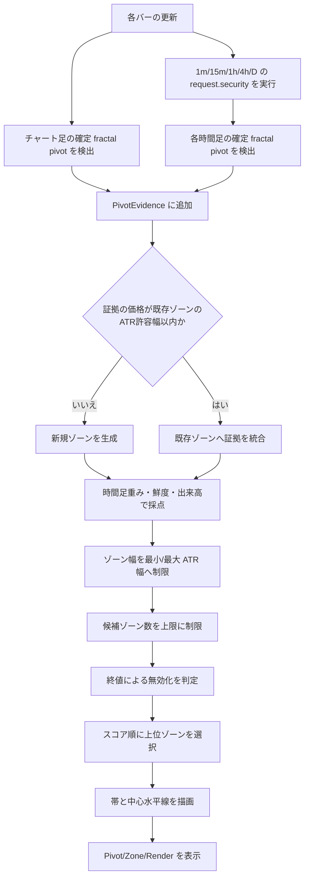

# 水平流動性ゾーン描画仕様

## 目的

本機能は、XAUUSD で市場参加者が意識しやすい支持・抵抗の候補を、単一価格の水平線ではなく価格帯として描画する Pine Script v6 インジケーターです。

1分、15分、1時間、4時間、日足の確定ピボットを証拠として扱い、近接する価格を統合して流動性ゾーンを作ります。各ゾーンには中心水平線を描きます。青はサポート、橙はレジスタンス、灰色は高値・安値の両方が重なるコンフルエンスです。

本機能はエントリー、決済、アラート、将来の価格予測を行いません。市場参加者が反応し得る価格領域を、観測可能な値動きから順位付けして可視化するためのものです。

## 表示要素

| 要素 | 意味 | 描画 |
| --- | --- | --- |
| サポートゾーン | 安値側ピボットを主な根拠にした帯 | 水色の帯、実線の水色中心線 |
| レジスタンスゾーン | 高値側ピボットを主な根拠にした帯 | 橙色の帯、実線の橙色中心線 |
| コンフルエンスゾーン | 高値・安値の両側の証拠が集まった帯 | 灰色の帯、実線の灰色中心線 |
| 無効化済みゾーン | 確定終値が帯の外側を抜けた帯 | 淡い帯、点線の中心線 |
| 集計ステータス | 現在の内部件数 | `Pivot`、`Zone`、`Render` を右端に表示 |

`Pivot` は収集済みのピボット証拠数、`Zone` は内部で保持している候補ゾーン数、`Render` はチャートに描画したゾーン数です。

ゾーンの起点が直前バーの開始時刻以降の場合は、そのバーでは描画を保留し、後続バーで描画対象にします。帯の境界は上下の水平線のみとし、左右の垂直な枠線は描画しません。中心線の右側は、直前バーと最新バーの異なるバー番号を使って水平に描画し、右へ延長します。市場クローズ中も最終バーで描画しますが、この条件は同じです。

### 帯の濃淡と線の見方

Pine Script の `color.new(color, alpha)` は、`alpha = 0` が不透明、`alpha = 100` が完全透明です。本機能では帯の濃淡を強度スコアや時間足ではなく、ゾーンが現在も有効かどうかの状態表示に使います。

| 状態 | 帯の透明度 | 境界線の透明度 | 中心線 | 読み方 |
| --- | ---: | ---: | --- | --- |
| 有効 | 72 | 0 | 不透明・実線・太さ3 | 現在も支持・抵抗候補として評価している帯 |
| 無効化済み | 84 | 45 | 透明度45・点線・太さ2 | 終値が ATR バッファを越えて帯を抜けた過去の帯 |

そのため、**帯が濃いほどスコアが高い**、または **上位足由来である**という意味ではありません。濃淡は「有効な候補を前景へ、無効化済みの履歴を背景へ」という視覚上の優先順位です。強さの比較には、スコアラベルを有効化して表示する `score | evidenceCount` と、帯の色、表示順位を使います。

無効化済みの帯を完全削除せずに薄く残す理由は、ブレイク地点、過去の利確・損切り集中帯、将来の再評価候補を確認できるようにするためです。ただし、現行仕様は無効化済み帯を自動で支持・抵抗へ反転しません。新しい確定ピボットが同価格帯へ集まった場合は、新しい有効ゾーンとして評価します。

## 処理フロー

### 1. 確定ピボットの抽出

各対象時間足で `ta.pivothigh()` と `ta.pivotlow()` を使います。ピボット強度を $s$ とすると、候補バーの左右にそれぞれ $s$ 本のバーが確定した時点で、その候補は高値または安値ピボットとして確定します。

- 高値ピボットはレジスタンス候補です。
- 安値ピボットはサポート候補です。
- 右側の確認バーが必要なので、ピボット確定後に価格が書き換わることはありません。

チャート足のピボットもフォールバックとして必ず収集します。上位足のリクエストがデータ条件で証拠を返さない場合でも、現在見ている時間足のゾーンが描画されます。

### 2. マルチタイムフレーム収集

対象は 1分、15分、1時間、4時間、日足です。上位足の値は `request.security(..., lookahead = barmerge.lookahead_off)` で取得し、未確定の上位足情報を先読みしません。

1分足の証拠は、完全な1分履歴を扱える1分足チャートでのみ収集します。5分足以上では、チャート足のフォールバックと15分以上の時間足証拠を使います。

### 3. 価格帯への統合

新しいピボット証拠の価格を $p$、比較用 ATR を $A$、クラスタ許容幅を $k_c$ とします。既存ゾーン中心 $z$ に対して、次を満たすと同じゾーンとして統合します。

$$
|p - z| \leq A \times k_c
$$

比較用 ATR は、15分 ATR と証拠元時間足の ATR の大きい方です。

$$
A = \max(ATR_{15m}, ATR_{source})
$$

さらに、中心距離の条件を満たさなくても、ピボット価格と既存帯の端との距離 $d_{edge}$ が `近接ゾーン統合距離` $k_a$ 以内であれば統合します。

$$
d_{edge} \leq A \times k_a
$$

初期値は $k_a = 0.30$ です。帯の間にわずかな隙間しかない候補を一つにまとめ、密集表示を抑えます。$k_a = 0$ にすると、この近接統合は無効になります。

各証拠を取り込んだ後、既存の有効ゾーン同士についても同じ端間距離の基準で繰り返し統合します。したがって、過去に別々に作られた帯も、スクリプトを再読込して履歴を再計算すると一つの候補へ集約されます。統合後は証拠数・時間足構成・スコアを合算し、役割が異なる場合はコンフルエンスゾーンにします。

ゾーン上下限は統合したピボット価格の最大値・最小値から作り、その幅を最小幅 $k_{min}$ と最大幅 $k_{max}$ の範囲に収めます。

$$
A \times k_{min} \leq zoneTop - zoneBottom \leq A \times k_{max}
$$

### 4. スコアリング

証拠1件の基礎スコアは、時間足重み $w_t$、鮮度減衰、任意の相対出来高加点で構成されます。

$$
score_{evidence} = w_t \times e^{-h / D} + \max(0, VR - 1) \times B_v
$$

| 記号 | 意味 |
| --- | --- |
| $w_t$ | 証拠元時間足の重み |
| $h$ | ピボットからの経過時間（時間） |
| $D$ | `鮮度半減係数 (時間)` の入力値 |
| $VR$ | ピボット時出来高 / 出来高 SMA(20) |
| $B_v$ | `相対出来高ボーナス` |

既存ゾーンに証拠が追加されると、上記に加えて `反応追加ボーナス` を加算します。したがって、同じ価格帯で繰り返される反応は、単独ピボットより高く評価されます。

## パラメーター仕様

### 時間足と重み

| パラメーター | 初期値 | 描画への影響 | 実務上の意味 |
| --- | ---: | --- | --- |
| 1分足 / 15分足 / 1時間足 / 4時間足 / 日足 | ON | 対象時間足の証拠収集を有効・無効化する | 不要な時間足を除外して帯の性格を絞る |
| 1分足の重み | 1.0 | 1分足証拠のスコアを増減 | 直近の執行足反応を補助的に反映する |
| 15分足の重み | 3.0 | 15分足証拠のスコアを増減 | 基本目線としての中核候補を強める |
| 1時間足の重み | 5.0 | 1時間足証拠のスコアを増減 | セッション内で多く観察される転換候補を強める |
| 4時間足の重み | 8.0 | 4時間足証拠のスコアを増減 | より広い参加者層が観測する価格帯を強める |
| 日足の重み | 13.0 | 日足証拠のスコアを増減 | 大きな参加者が参照しやすい長期価格帯を優先する |

重みは優位性を保証する値ではありません。上位足ほど観察者が多く、注文・リスク管理の基準になりやすいという仮説を、表示順位へ反映するための初期値です。

### ZigZag / ピボット

| パラメーター | 初期値 | 描画への影響 | トレードオフ |
| --- | ---: | --- | --- |
| ATR期間 | 14 | クラスタ許容幅、ゾーン最小幅・最大幅、無効化バッファの価格尺度になる | 小さいと最近の変動へ敏感、大きいと帯の尺度が安定する |
| ピボット強度 | 3 | 左右何本で高安値を確定するか。大きいほど候補数が減る | 小さいと早いがノイズ増、大きいと重要度は上がりやすいが遅延する |

### 流動性ゾーン

| パラメーター | 初期値 | 描画への影響 | トレードオフ |
| --- | ---: | --- | --- |
| ピボット証拠の保持数 | 160 | 統合・採点の対象として残すピボット件数 | 大きいほど過去を残すが、古い証拠が候補を占有しやすい |
| 候補ゾーン上限 | 40 | 内部で管理するゾーン数 | 小さいほど高順位へ集中し、大きいほど探索範囲が広がる |
| 表示最小スコア | 0.0 | この値未満のゾーンを非表示にする | 上げると弱い帯を除去できるが、新しい候補も隠れる |
| 描画重複抑制率 | 0.60 | 高スコア帯と大きく重なる低スコア帯を描画から除外する | 0で無効化。上げるほど重複を許容し、下げるほど帯を強く間引く |
| クラスタ許容幅 (15分ATR) | 0.55 | 近接ピボットを同じ帯へ統合する距離 | 小さいと細かい線が増え、大きいと別の価格帯を混ぜやすい |
| 近接ゾーン統合距離 (ATR) | 0.30 | 帯の端からこの距離以内のピボットを既存帯へ統合する | 0で無効化。大きいと密集を減らせるが、隣り合う別の価格帯も混ざりやすい |
| 最小ゾーン幅 (ATR) | 0.20 | 帯の最低厚み | 小さいと精密だが視認しにくく、狭すぎる約定誤差を無視しやすい |
| 最大ゾーン幅 (ATR) | 1.20 | 帯の最大厚み | 小さいと曖昧な広帯を抑え、大きいと広いレンジの反応を保持する |
| 反応追加ボーナス | 0.8 | 同一帯に追加証拠が来たときのスコア加点 | 上げると反復反応を強く優先する |
| 相対出来高ボーナス | 0.5 | 出来高が SMA(20) を上回るピボットへの加点 | ティック出来高の品質が低いフィードでは小さくするか0にする |
| 鮮度半減係数 (時間) | 336 | 古い証拠のスコア低下速度 | 小さいと新しい帯を優先し、大きいと長期帯を保持する |
| 無効化バッファ (ATR) | 0.15 | 帯の外側へどれだけ抜けたら無効化するか | 小さいと早く失効し、大きいとヒゲ・小さなオーバーシュートを許容する |
| 有効ゾーン最大寿命 (時間) | 720 | 作成から指定時間を過ぎた有効ゾーンを削除する | 時間足に関わらず古い帯を除去する。新しい証拠が追加されても延命しない |
| 無効ゾーン保持時間 | 120 | 無効化後に点線として残す時間 | 長いと検証しやすく、短いと画面を整理できる |

### 表示

| パラメーター | 初期値 | 描画への影響 |
| --- | --- | --- |
| 表示ゾーン数 | 12 | スコア上位から描画する最大数 |
| サポート | 水色 | サポート帯と中心線の色 |
| レジスタンス | 橙色 | レジスタンス帯と中心線の色 |
| コンフルエンス | 灰色 | 高値・安値の両方が統合された帯と中心線の色 |
| スコアラベル | OFF | ゾーンごとに `score | evidenceCount` を表示 |
| 集計ステータス | OFF | `Pivot / Zone / Render` の内部件数を表示 |

### 描画時の重複抑制

内部のゾーン候補は削除せず、描画時だけスコア上位から選びます。すでに描画した高スコア帯と候補帯の共通価格幅を $W_{overlap}$、狭い方の帯幅を $W_{narrow}$、`描画重複抑制率` を $T$ とすると、次を満たす低スコア候補は描画しません。

$$
\frac{W_{overlap}}{W_{narrow}} \geq T
$$

初期値 $T = 0.60$ は、狭い方の帯の60%以上が高スコア帯と重なる候補を非表示にします。少しだけ接する帯は残るため、隣接する別の価格帯まで一律に失いません。`0` にすると重複抑制を無効化して、従来どおり上位候補をすべて描画します。

## 組み込んだ理論と狙い

### 確定 swing point

価格は過去の明確な高値・安値で一時停止、反転、ブレイク、または損切り注文の集中を起こしやすいという市場構造の考え方を使います。左右のバーで確認された pivot のみを採用することで、進行中の足に合わせて位置が変わる未確定高安値を排除します。

期待される利点は、誰が見ても認識しやすい局所高安値へ候補を限定できる点です。代わりに、確認に必要なバー数分だけ遅れて検出されます。

### マルチタイムフレーム・コンフルエンス

同一に近い価格を複数時間足で高値・安値として観測できるとき、その価格は短期参加者だけでなく中期・長期参加者の基準にもなっている可能性があります。時間足重みはこの仮説を定量化するものです。

期待される利点は、1分足だけの偶発的な折り返しを、15分・1時間・4時間・日足の証拠で相対的に抑えられることです。複数時間足の一致は反応確率を保証するものではなく、ニュース、流動性の薄い時間帯、データソース差で機能は弱まります。

### ATR 正規化

XAUUSD はボラティリティ水準が時間帯・相場局面で変わるため、固定ドル幅だけで近接価格を同一ラインと見なすと、静かな局面では粗く、急変局面では細かすぎます。ATR を距離と帯幅の尺度に使うことで、相場の変動幅に対して相対的な価格帯を扱います。

期待される利点は、価格の絶対値ではなく現在のノイズ水準に対する距離で候補を統合できることです。急なイベントで ATR が拡大すると、帯も広くなりやすい点には注意が必要です。

### 反復反応と流動性仮説

同じ帯で高値・安値ピボットが繰り返されるとき、その帯には成行注文の吸収、指値注文、利確・損切り、再評価が集まっている可能性があります。実装では、同一ゾーンへの証拠追加に反応ボーナスを与えます。

期待される利点は、単発の swing よりも、再訪・再反応を経験した帯を上位に出せることです。ただし、単にレンジが続いただけでも反応回数は増えるため、ブレイク後の無効化と鮮度減衰を併用します。

### 相対出来高

ピボット時の出来高を SMA(20) と比較し、平均以上の出来高だけを補助的に加点します。相対値にすることで、取引時間やブローカーごとの絶対出来高の違いを緩和します。

期待される利点は、通常より参加が多い反応を上位に出せる可能性があることです。XAUUSD の TradingView 出来高は多くの場合ティック出来高であり、集中取引所の実出来高ではありません。そのため本実装では必須条件にせず、加点だけにしています。

### 鮮度と無効化

時間が経過した帯は、市場参加者の記憶や未約定注文が減る可能性があります。終値が帯を ATR バッファ分だけ超えると、その役割は失われたと判断して点線化します。

期待される利点は、過去の全価格を同じ強さで扱わず、最近も守られている帯を優先できることです。一方で、無効化済み帯が後にレジサポ転換するケースは、この初期仕様では新しい証拠として再評価されます。旧帯を自動で反対役割に反転する機能は未実装です。

有効ゾーンにも最大寿命を設けています。作成時刻から `有効ゾーン最大寿命 (時間)` が経過すると、価格がまだ帯を抜けていなくても削除します。これは遠い過去の価格帯が現在の執行画面を占有することを防ぐためのハード上限です。初期値の720時間は30日です。

#### 鮮度スコアの現行仕様と毎バー再計算

現行実装では、ピボット証拠をゾーンへ追加した時点で、その証拠の経過時間に応じた減衰を一度だけスコアへ反映します。以後、証拠が増えないゾーンの保存済みスコアは毎バーは低下しません。最大寿命はこの弱点を補うハード上限です。

「毎バー鮮度でスコアを再計算する」とは、各バーで全ゾーンの現在スコアを再評価し、古い証拠だけのゾーンを表示順位から自然に落とす仕組みです。概念的には、ゾーン $z$ に属する全証拠 $E_z$ に対して次を毎バー計算します。

$$
score_z(t) = \sum_{e \in E_z} \left(w_e \times e^{-(t - t_e) / D} + volumeBonus_e\right) + reactionBonus_z
$$

| 要素 | 意味 |
| --- | --- |
| $t$ | 現在時刻 |
| $t_e$ | 証拠ピボットの確定時刻 |
| $w_e$ | 証拠元時間足の重み |
| $D$ | 鮮度半減係数 |
| $reactionBonus_z$ | 反復反応によるゾーン加点 |

例えば、同じ初期スコアのゾーンAとBがあり、Aは3日前、Bは20日前の証拠だけで構成されるとします。毎バー再計算なら、時間の経過とともにBの順位がAより下がり、`表示ゾーン数` の上位から外れます。どちらも最大寿命に達するまで削除はされません。つまり、最大寿命は「必ず消す期限」、毎バー再計算は「期限前でも古い帯を徐々に見えにくくする順位付け」です。

この拡張には、ゾーンに属する各証拠のスコア構成を保持して毎バー合計し直す必要があります。現行の `LiquidityZone` は集計済みスコアだけを保持するため、実装する場合は証拠別の基礎スコア・確定時刻をゾーンへ関連付けるデータ構造を追加します。

## 推奨する初期調整

| 利用場面 | ピボット強度 | 表示最小スコア | 表示ゾーン数 | クラスタ許容幅 |
| --- | ---: | ---: | ---: | ---: |
| 1分足のエントリー補助 | 3-5 | 3-5 | 6-8 | 0.35-0.50 |
| 15分足の基本目線 | 3-6 | 4-6 | 6-10 | 0.40-0.55 |
| 4時間足・日足の構造確認 | 5-8 | 5-8 | 4-8 | 0.35-0.50 |

上記は調整開始点であり、最適値ではありません。XAUUSD の銘柄表記、ブローカーのティック出来高、観測期間、ニュース時間帯により結果が変わります。Bar Replay で、帯を形成した証拠、反応回数、ブレイク後の挙動を確認してから固定値を決めてください。

## 既知の実装上の注意

- 現在のチャート足フォールバックは、表示している時間足の pivot を15分足相当の重みとして登録します。これは上位足リクエストが空になる条件でも描画を継続するための互換経路です。
- `Pivot` が0の場合、ピボット強度、履歴バー数、対象時間足の有効化状態を確認してください。
- 1分足の証拠は1分足チャートでのみ完全に収集されます。
- インジケーターは候補帯を可視化するだけであり、損失制限、ポジションサイズ、ニュース回避などのリスク管理を代替しません。

## 関連実装

- [src/domain/zigzag.pine](../src/domain/zigzag.pine): 確定 fractal pivot の抽出
- [src/application/mtf_pivot_collector.pine](../src/application/mtf_pivot_collector.pine): 各時間足の証拠収集
- [src/application/liquidity_zone_engine.pine](../src/application/liquidity_zone_engine.pine): クラスタリング、採点、無効化
- [src/presentation/zone_renderer.pine](../src/presentation/zone_renderer.pine): 帯と中心水平線の描画
- [src/presentation/settings.pine](../src/presentation/settings.pine): 入力パラメーター
